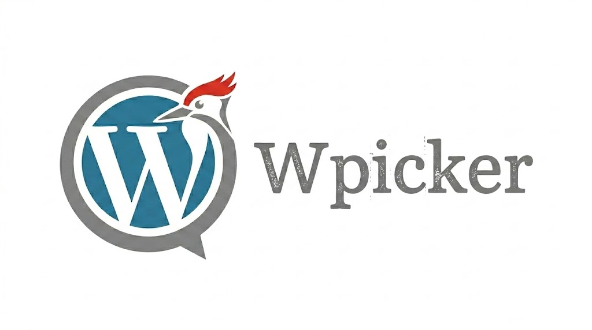
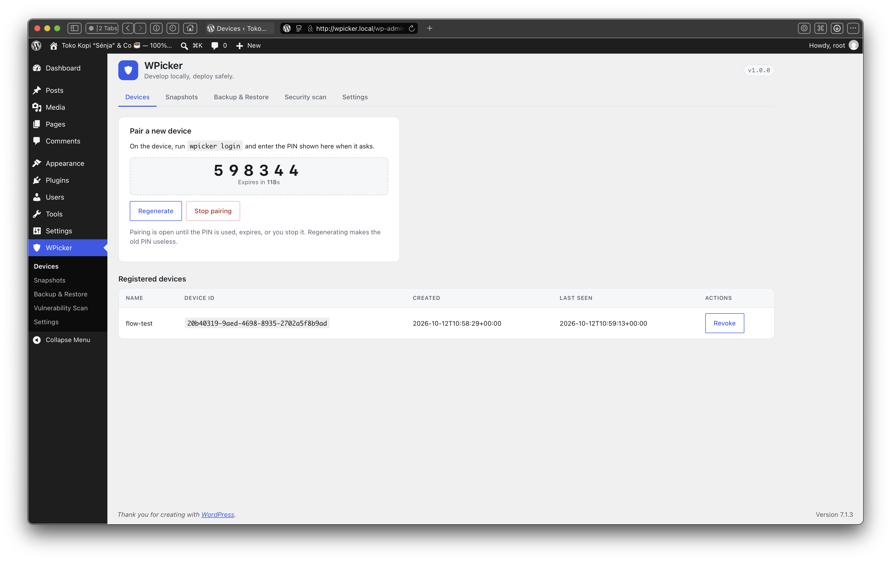
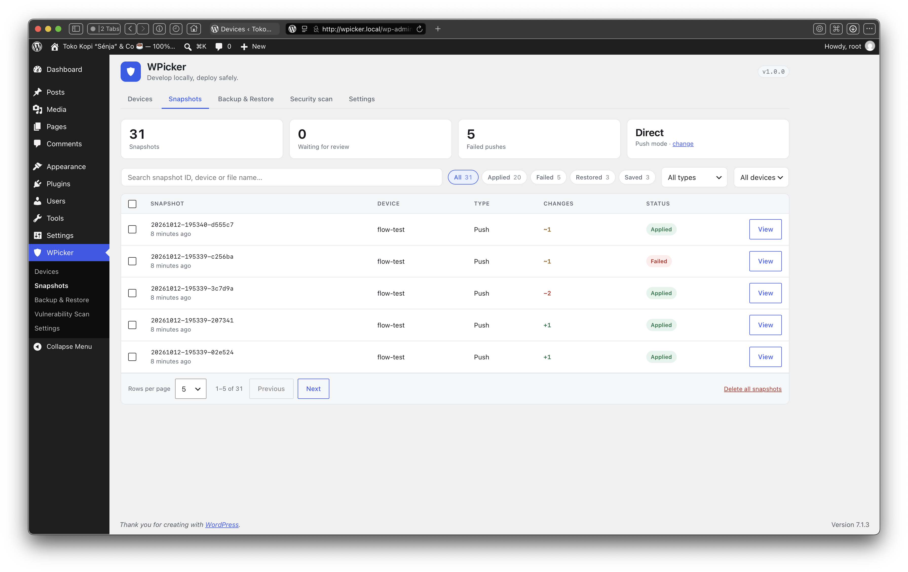
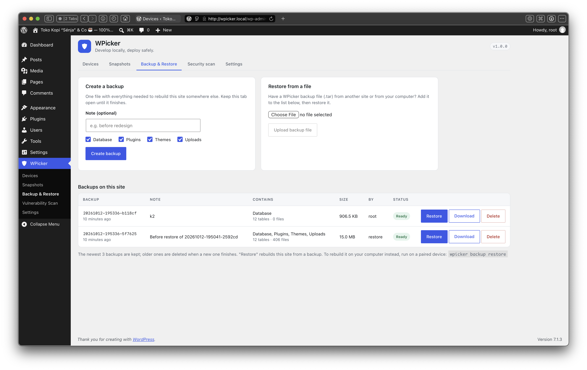
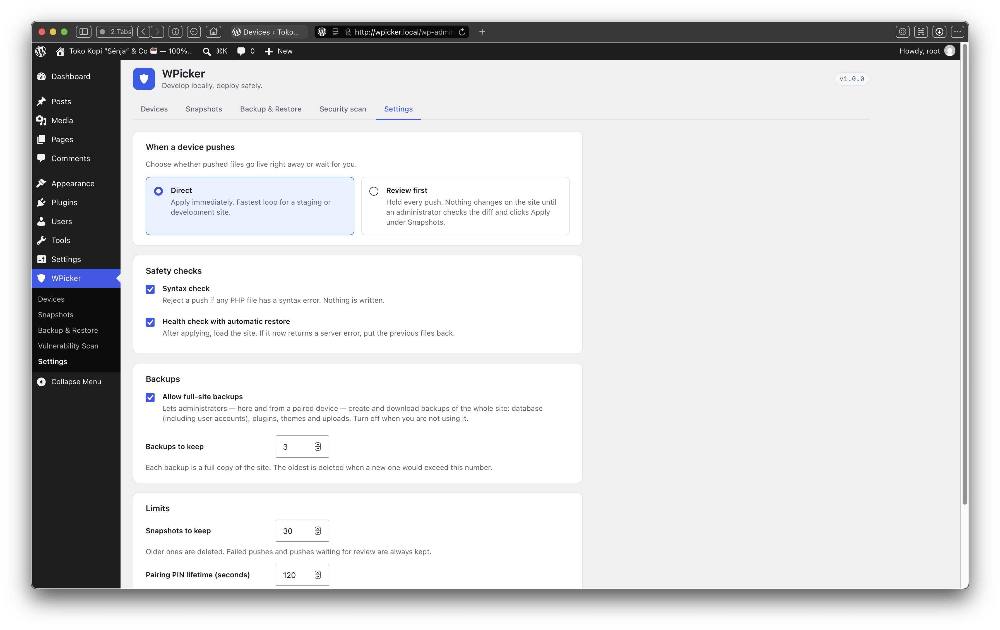
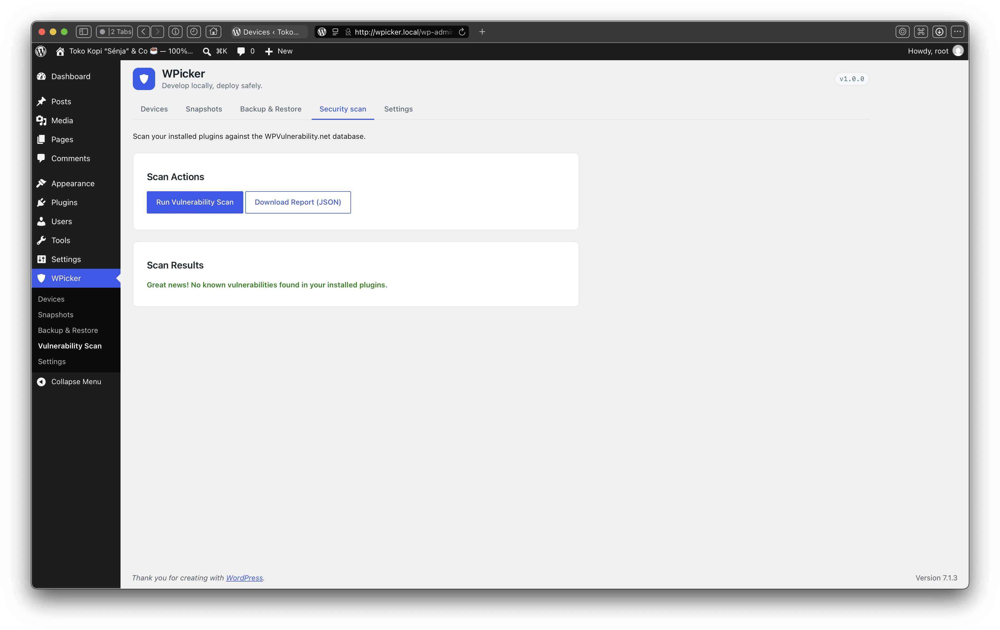

<p align="center">
  
</p>

# WPicker: AI-Native WordPress Bridge
[](LICENSE)
[](https://www.virustotal.com/)
[](https://golang.org)
[](https://php.net)

**WPicker** (a playful nod to the hardworking *woodpecker* 🐦) lets you develop a WordPress site on your own machine — with or without an AI agent — and move the work to the live site with one command, instead of the usual backup → upload → restore routine.

It has two halves:

| | Runs on | Does |
|---|---|---|
| **Plugin** | the WordPress site | Receives changes, checks them, keeps snapshots and backups |
| **CLI** (`wpicker`) | your computer | Pulls, pushes, merges, clones |

> [!WARNING]
> Use it on **staging, development, or local sites**, or on production only with backups you have tested. Deactivate and remove the plugin when you are done with it.

## Preview

| Pair a device with a one-time PIN | Every push is a snapshot you can inspect, revert or restore |
|:---:|:---:|
| [](screenshots/devices.png) | [](screenshots/snapshots.png) |
| **Full-site backup and restore, or restore from a file** | **Direct or review-first pushes, safety checks, limits** |
| [](screenshots/backup-restore.png) | [](screenshots/settings.png) |
| **Scan installed plugins for known vulnerabilities** | |
| [](screenshots/security-scan.png) | |

**Contents:** [Quick start](#quick-start) · [Daily work](#daily-work) · [Working as a team](#working-as-a-team) · [Undoing things](#undoing-things) · [Backup & restore](#backup--restore) · [AI agents](#using-it-with-an-ai-agent) · [Command reference](#command-reference) · [Limits](#what-it-does-not-do)

---

## Quick start

### 1. Install the plugin on the site

1. Download `wpicker.zip` from the [latest release](https://github.com/febritecno/wpicker/releases/latest).
2. In WP-Admin go to **Plugins → Add New Plugin → Upload Plugin**, choose the zip, **Install Now**, then **Activate**.
3. A **WPicker** menu appears in the sidebar.

The site needs:

- PHP 7.4 or newer, with the `php` command available to the web server (used to syntax-check pushed files).
- An **active child theme**, if you want to sync theme files. WPicker only ever writes inside the child theme — never the parent theme, core, or `wp-config.php`.
- HTTPS (or `WP_ENVIRONMENT_TYPE` set to `local`) for pairing with a password.

### 2. Install the CLI on your computer

macOS / Linux:

```bash
curl -sL https://raw.githubusercontent.com/febritecno/wpicker/main/install.sh | bash -s -- install
wpicker --help
```

The installer also teaches the AI agents it finds in your home directory (Claude Code, Codex, Gemini CLI) how to use WPicker, so `/wpicker` works in Claude Code right away. Skip that with `bash -s -- install --no-agents`.

Other agents are set up per project, from the project folder:

```bash
wpicker connect                    # the agents it finds in this project (else AGENTS.md)
wpicker connect --agent all        # Claude Code, Cursor, Codex, Gemini, Copilot, Windsurf, Cline
wpicker connect --agent claude --global
```

Safety: the instruction files are only written inside the project (never through a symbolic link that leads out of it), a file you wrote is never replaced without `--force`, and `login` asks before touching a project. Run `connect` as yourself, not with `sudo`. Your pairing is per user, not per project, so when you open a repository you do not trust, do not let your agent run `wpicker` freely there: allow only the read-only commands (`map`, `logs`, `find`, `files`, `db`, `guide`) and keep `theme push` and `rollback` on ask.

Agents that read a file in every conversation get a short pointer and fetch the full instructions with `wpicker guide` only when the task is about the site. Files you already have (`AGENTS.md`, `GEMINI.md`) only get a marked block added. Run `wpicker connect` again after upgrading to refresh.

Change `install` to `remove` to uninstall. To build from source instead (Go 1.21+):

```bash
git clone https://github.com/febritecno/wpicker && cd wpicker
make build-cli          # → bin/wpicker
```

Keep the plugin and the CLI on the same version; `wpicker login` warns when they differ.

### 3. Connect the CLI to the site

```bash
wpicker login
```

It asks for the site URL, an administrator username and password, and a **6-digit PIN**. The PIN appears in **WP-Admin → WPicker → Devices** the moment you run the command — read it there and type it in.

- The password is used once to pair and is never stored. The CLI keeps a separate, revocable credential for this device in `~/.wpicker/sites.json` (readable only by you).
- You can pair **several sites**; logging in to another one does not touch the first. See them with `wpicker sites`.
- Check which site a folder uses with `wpicker whoami`, or ask the site to describe itself with `wpicker context`.
- Remove a site any time with `wpicker sites delete <id>` (it also revokes this computer on the site), or from WP-Admin → WPicker → Devices.

#### Several sites and several folders

Each project folder works with one site. `wpicker theme pull` links the folder to the site it pulled from (a small `.wpicker/project.json`, no secrets), and from then on every command in that folder uses that site. For any other folder:

```bash
wpicker sites                  # id, name, address, user, status, linked folders
wpicker sites link shop        # use "shop" in this folder from now on
wpicker --site blog logs       # one command against another site
wpicker sites stop blog        # keep its login but refuse to use it (start to undo)
wpicker sites delete blog      # forget it and revoke this computer on it
```

With one site nothing needs choosing. With several, commands that only *look* (logs, map, files) fall back to your default site (`wpicker sites use <id>`) and say so on stderr; commands that *change* a site (theme push, rollback, page, restore) refuse to guess and ask you to link the folder or pass `--site`. `--site` takes an id, name or address of a site you are already logged in to; it can no longer point your login at another address.

Upgrading: your existing login is picked up automatically as site 1. `~/.wpicker/config.json` is left untouched, so an older `wpicker` binary on your PATH keeps working with it.

### 4. Get the site onto your computer

Pick one.

**A. The whole site** — database, plugins, themes, uploads. This is the one that replaces "export a backup, import it locally".

Create an empty WordPress locally first (for example with [Local](https://localwp.com)), then:

```bash
wpicker clone --path "/path/to/local/wordpress"
```

`--path` is the folder containing `wp-config.php`. The command backs the site up, downloads one archive, unpacks it, loads the database and rewrites every address to your local one. Your previous local database and folders are saved to `wpicker-before-restore-<time>/` first. Afterwards you log in locally with the same accounts as on the site.

Database settings are read from the local `wp-config.php` (sites made with Local are detected automatically). Override them if needed: `--db-host`, `--db-port`, `--db-socket`, `--db-name`, `--db-user`, `--db-pass`, and `--url` for the local address.

**B. Only the child theme** — when you just want to work on theme code.

```bash
mkdir my-child-theme && cd my-child-theme
wpicker theme pull
```

After a clone you already have the theme: `cd` into `wp-content/themes/<child-theme>` and carry on from there.

---

## Daily work

Run these inside the child theme folder.

```bash
wpicker theme status     # what would be pushed, what could be pulled, conflicts
# ...edit files, check them on your local site...
wpicker theme push       # send your changes to the site
```

What `push` does on the site, in order:

1. **Syntax check** every PHP file. An error rejects the push; nothing is written.
2. **Snapshot** the theme as it is now.
3. Write your files (and delete the ones you deleted).
4. **Health check**: load the site. If it now returns a server error, the snapshot is put back automatically and you get the PHP error with file and line.

So a bad push does not take the site down, and you are told what to fix.

To pick up changes made on the site:

```bash
wpicker theme pull       # lists them; you choose which to apply
```

```
Changes on https://example.com not in your local copy:
   1) A  inc/helpers.php
   2) M  style.css
   3) C  functions.php   (changed on both sides — merged line by line; …)
Apply which? [a]ll (merging where needed) · numbers (1,3 or 2-4) · d <n> to view diff · [q]uit >
```

`wpicker theme diff [file]` shows the line-by-line difference between your copy and the site.

---

## Working as a team

Several people (or agents) can be paired with the same site. WPicker never lets one silently overwrite another.

If someone pushed while you were editing, your push is refused and `status` says who:

```
Conflicts (changed on both sides):
  C  inc/shop.php   (ani-laptop, 2026-10-13 14:02)
```

Run `wpicker theme pull`. Files changed on both sides are **merged line by line**, like git:

- Edits to different lines are simply combined.
- Where you both changed the same lines, both versions are kept between markers:

  ```
  <<<<<<< yours
  	return 'IDR ';
  =======
  	return 'Rp';
  >>>>>>> site (ani-laptop, 2026-10-13 14:02)
  ```

  Open the file — VS Code, Cursor and JetBrains show their merge controls for these — settle each block, delete the marker lines, and push. A push is refused while markers remain. Your pre-merge version is in `.wpicker/merge-backup/`.

To take one side outright instead of merging:

```bash
wpicker theme pull --theirs functions.php       # the site's version
wpicker theme pull --keep-local functions.php   # yours; the next push overwrites the site's
```

Images, fonts and other binary files cannot be merged; you choose a side.

**Review before it goes live.** In **WP-Admin → WPicker → Settings**, set *When a device pushes* to **Review first**. Pushes are then held: an administrator opens **Snapshots**, reads the diff, and clicks **Apply to site** or **Reject**. A device cannot approve its own push.

---

## Undoing things

Every push is recorded under **WP-Admin → WPicker → Snapshots** (search, filter, and a side-by-side diff of each file). From there, or from the CLI:

| Action | What it does |
|---|---|
| **Revert this push** | Undoes that one push. Later pushes are kept. |
| **Restore to before this** (`wpicker rollback <id>`) | Puts the whole theme back to how it was before that entry. Later pushes are undone too. |

`wpicker snapshots` lists them. If a revert collides with a later change, you decide per file which version stays.

---

## Backup & restore

**WP-Admin → WPicker → Backup & Restore** — full-site backups, each a single `.tar` file.

- **Create a backup** of the database, plugins, themes and uploads.
- **Restore** any listed backup onto the site. The database is loaded into temporary tables first and switched over at the end, and the current site is backed up before anything changes.
- **Restore from a file** — upload a backup made on another site. Addresses are rewritten to the destination's automatically, so this is also how you move a whole site from one place to another.

From the CLI:

```bash
wpicker backup list
wpicker backup create --note "before redesign"
wpicker backup restore --path "/path/to/local/wordpress"   # pick one, rebuild it locally
wpicker clone --path "/path/to/local/wordpress"            # create + restore in one go
```

Restoring replaces the destination's content and user accounts with the backup's; you log in again with an account from the backup.

---

## Diagnosing a site

Off by default. Turn on **Diagnostic access** in **WP-Admin → WPicker → Settings**; a paired administrator device (you, or your AI agent) can then look at the site without changing it:

```bash
wpicker logs --since 1h                 # PHP + WordPress errors, grouped, with file and line
wpicker debug on                        # record every warning, notice and deprecation…
wpicker logs --since 5m --trace         # …reproduce the problem, then read them
wpicker debug off

wpicker files ls plugins/my-plugin      # any code under wp-content
wpicker files cat plugins/my-plugin/main.php --lines 80-120
wpicker files grep "add_action( 'init'" plugins

wpicker db tables
wpicker db query "SELECT ID, post_title, post_status FROM wp_posts ORDER BY ID DESC LIMIT 10"
```

- **Logs** come from PHP's error log, `wp-content/debug.log`, and WPicker's own log. `wpicker debug on` does what `WP_DEBUG` + `WP_DEBUG_LOG` do — everything is logged, nothing is shown to visitors — without editing `wp-config.php`.
- **Files** are read-only and limited to `wp-content`. `wp-config.php`, backups, key files and database dumps are not available.
- **Database** queries are read-only: `SELECT`, `SHOW`, `DESCRIBE`, `EXPLAIN`, one statement, run in a read-only transaction. Credentials are out of reach — the password columns do not exist for these queries, rows holding keys, tokens, salts or sessions are left out, and tables that are credential stores by name are refused.

Everything else in the database **can** be read, including customer and personal data, and whatever an AI agent reads is sent to its provider. Each access is listed under Settings → *Recent diagnostic access*. Switch it off when you are done.

---

## Using it with an AI agent

There is nothing to set up per project. The installer teaches Claude Code, Codex and Gemini CLI about WPicker, and `wpicker login` sets up whichever agents it finds in the folder you log in from (Cursor, Copilot, Windsurf, Cline too). In Claude Code, ask about your site or type `/wpicker`. `wpicker update` refreshes the instruction files WPicker wrote, so they never go stale; `wpicker guide` prints the full instructions an agent follows.

- Every command takes `--json` for machine-readable output.
- `wpicker context` gives the agent the facts it would otherwise guess: WordPress and PHP versions, active theme, plugins, theme settings.
- A failed push writes `.wpicker/last-error.json` with the error code, message, file and line, so the agent can fix and retry on its own.
- Without a terminal, `wpicker theme pull` applies everything and merges where needed instead of prompting; `wpicker backup restore` needs `--yes`.

Works with any agent that can run shell commands (Claude Code, Cursor, Copilot, and others).

---

## Command reference

Global flags: `--json`, `--site <id|name|address>`, `-v`.

| Command | Purpose |
|---|---|
| `wpicker login [address]` | Pair this computer with a site (add it, or pair it again) |
| `wpicker sites` | List your sites with live status and linked folders |
| `wpicker sites login\|stop\|start\|delete\|use <id>` | Re-pair, switch off/on, forget (revokes this computer), make default |
| `wpicker sites link [id]` / `unlink` | Use a site in this folder from now on / stop |
| `wpicker whoami` | Which site this folder uses, and why |
| `wpicker doctor` | Checklist: is WPicker itself set up and working |
| `wpicker device list` / `revoke <id>` | Advanced: every computer paired with the site |
| `wpicker context [--save]` | Site facts for you or your agent |
| `wpicker connect [--agent …]` | Write the instructions AI agents follow (Claude Code skill `/wpicker`, `AGENTS.md`, Cursor, Gemini, Copilot, Windsurf, Cline); `--refresh` updates the ones already written |
| `wpicker guide` | Print the full agent instructions |
| `wpicker theme status` | To push, to pull, conflicts — and who pushed |
| `wpicker theme diff [path…]` | Line diff, local vs. site |
| `wpicker theme pull [path…]` | Apply changes from the site, merging where needed |
| `  --all` `--dry-run` | Everything without asking / list only |
| `  --theirs <path>` `--keep-local <path>` `--force` | Take the site's version / keep yours / make local match the site |
| `wpicker theme push` | Send local changes (`--dry-run`, `--all`) |
| `wpicker theme files` | List the theme's files on the site |
| `wpicker snapshots` (alias `history`) | Push history |
| `wpicker rollback <id>` | Restore the theme to before a snapshot |
| `wpicker backup list` / `create` / `download <id>` / `delete <id>` | Full-site backups on the site |
| `wpicker backup restore [id] --path <dir>` | Rebuild a backup on a local WordPress |
| `wpicker clone --path <dir>` | Back up the site and restore it locally |
| `wpicker page create --title … --builder divi\|elementor\|gutenberg --file …` | Create a page from a builder payload |
| `wpicker page update <post-id> --builder … --file …` | Update one |
| `wpicker logs` (`--since`, `--level`, `--grep`, `--trace`) | The site's errors, grouped |
| `wpicker debug on` / `off` / `status` | WordPress debug logging |
| `wpicker files ls` / `cat` / `grep` | Read code under wp-content |
| `wpicker db tables` / `db query "<sql>"` | Read-only database access, without credentials |
| `wpicker scan` | Check installed plugins against a vulnerability database |
| `wpicker update` | Update the CLI |

`wpicker <command> --help` has the details.

---

## What it does not do

- **Theme sync is the child theme only.** Plugins, uploads and the database travel through backups, as a whole — not file by file or page by page.
- **Restoring a backup from the CLI targets your computer.** Restoring onto a site is done in its WP-Admin.
- **Multisite networks** are not supported for backups.
- **Email addresses** at the old domain are left as they are when a site is moved.
- Sites of many gigabytes have not been tested.

---

## Developing WPicker

```bash
make dev        # WordPress in Docker (wp-env) at http://localhost:8888, admin / password
make build-cli  # bin/wpicker
make test       # Go tests + PHP syntax check
make sim        # end-to-end push / pull / merge scenarios against two local sites
make mirror     # site-to-site backup + restore check — overwrites the target site
```

`context.md` describes the architecture, the REST API and how each piece works.

## 🛡️ Security & VirusTotal

The CLI binaries and the plugin zip are built from this repository. You are encouraged to scan downloaded release assets with [VirusTotal](https://www.virustotal.com/); new Go binaries on Windows are sometimes flagged by mistake.

Pairing uses WordPress Application Passwords, one per device and revocable; your administrator password is never stored. Approving a held push, deleting snapshots and restoring a backup onto a site can only be done by an administrator signed in to WP-Admin — not by a paired device.

---

## 📜 License

All Rights Reserved.
